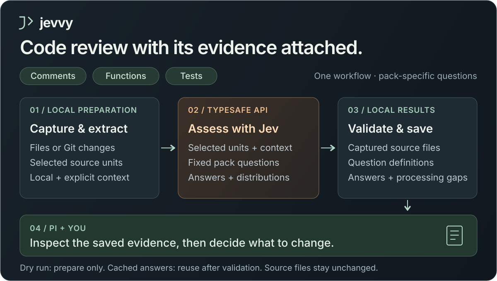
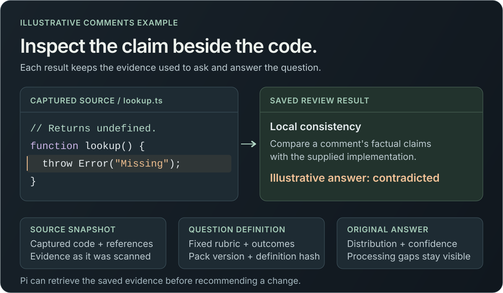

# jevvy

Structured review of comments, functions and tests for [Pi](https://pi.dev/), powered by
[Jev](https://docs.typesafe.ai/).

Jevvy extracts selected source, asks a fixed set of review questions, and saves the
answers alongside the code and question definitions used to produce them. You and
Pi can inspect that evidence before recommending changes. Scans leave source files
unchanged.

## What it reviews

Each **pack** supplies questions for one kind of source unit:

| Pack | What it assesses |
| --- | --- |
| **Comments** | Purpose, clarity, specificity, reader value, ambiguity, and consistency with the supplied implementation. |
| **Functions** | Redundant checks, hidden required failures, unnecessary indirection, unused flexibility, avoidable nesting, and paths denied by an explicit permission rule. |
| **Tests** | Application-owned behavior, gaps between claims and assertions, mocks that bypass the subject, repeated expected-value logic, and irrelevant fixture setup. |

Source parsing supports JavaScript/JSX, TypeScript/TSX, Rust, Python and Solidity.
The Functions and Tests packs adapt [Kiln Code Savers](docs/packs.md#source-and-license)
rubrics and include narrow checks developed through live Jev experiments.
See [pack questions and evidence requirements](docs/packs.md).



## Install and preview

Install [Pi](https://pi.dev/) first. Jevvy requires Node 26 on macOS or glibc Linux,
with an ARM64 or x64 processor.

```sh
pi install npm:jevvy
```

Restart Pi after installation. Use `pi install -l npm:jevvy` to install for the
current project only. Parser packages and their prebuilt binaries install
automatically; supported platforms need no manual build or approval for the Python
and Rust parsers. See [tested environments](docs/verification.md#platform-and-host).

Start Pi at your project's root and preview a scan of your uncommitted changes:

```sh
cd /path/to/your/project
pi
```

Inside Pi:

```text
/jevvy comments --working --dry-run
```

A dry run prepares the source and questions without making API calls or requiring
a TypeSafe key. A clean working tree has no changes to review; use a named file
instead, replacing the path with one in your project:

```text
/jevvy comments --files src/example.ts --dry-run
```

## Run a live scan

Get a key from the [TypeSafe dashboard](https://console.typesafe.ai/keys), then set
it in your shell before starting Pi:

```sh
export TYPESAFE_API_KEY='your-typesafe-api-key'
pi
```

Remove `--dry-run` to run the analysis using your TypeSafe account:

```text
/jevvy comments --working
/jevvy functions --files src/orders.ts
/jevvy tests --files test/orders.test.ts --context-files src/orders.ts package.json
```

For Functions and Tests, supply related implementations, manifests and contracts
with `--context-files`. Supporting files come from the selected snapshot and share
the context budget with local evidence. Missing evidence remains visible; Jevvy
does not infer a complete call graph or test suite.

## Choose a scope

All three packs support these scope options. Replace `comments` with `functions`
or `tests` as needed.

| Scope | Example |
| --- | --- |
| Named files | `/jevvy comments --files src/example.ts src/other.ts` |
| Working changes | `/jevvy comments --working` |
| Branch changes | `/jevvy comments --base origin/master --head HEAD` |

Working scans compare against HEAD and include non-ignored untracked files.
Branch scans compare the base/head merge-base with head; use your project's base
branch in place of `origin/master`. Diff scans also select unchanged comments
attached to changed code.

For `--files`, paths are relative to Pi's working directory. With `--working` or
`--base`, `--context-files` paths are relative to the Git repository root. Starting
Pi at the repository root keeps these path bases the same.

Add `--dry-run` to preview any scan, or use `/jevvy cancel` to stop a running scan.

## Inspect the results

Each scan saves a **bundle**: the captured source, question definitions, answers
and processing details. The result card shows coverage, errors and the bundle ID.
Completed answers remain available after cancellation or failures in other
requests.



Open the inspector to browse selected units, saved source and question definitions:

```text
/jevvy inspect <bundle-id>
```

Left and right change pages, up and down scroll, and Tab switches views. Escape
or your configured Pi cancel key closes the inspector.

Retrieve an overview or a page of source units:

```text
/jevvy results <bundle-id>
/jevvy results <bundle-id> --view units --limit 5 --include-context --include-definitions
```

Pi can call `jevvy_comments`, `jevvy_functions`, `jevvy_tests` and `jevvy_results`
directly. Reading saved results makes no API calls. The [sample report](examples/jevvy-results.example.md)
shows the output format with synthetic values.

For a **Tests bundle**, rank the `owned_behavior` question by its `issue` outcome
to inspect candidates whose assertions appear to repeat only dependency-owned
behavior:

```text
/jevvy results <bundle-id> --view units --labels owned_behavior --sort owned_behavior --outcome issue --include-context --include-definitions
```

Optional `--min-probability 0.8 --min-confidence 0.7` filters apply to saved answers;
those example cutoffs are review settings, not calibrated accuracy guarantees.
Full distributions, unknown outcomes and unfiltered results remain available.
Check the supplied evidence before accepting a candidate. A scan that raises no
candidate does not establish that the code or tests are correct.

## Data and settings

Live scans send selected units and their bound context to TypeSafe. Context can
include an entire small file. Reports and retrieved code enter Pi's model
conversation. Bundles store full captured files locally, preserving the source
as it was when scanned.

Bundles and cached answers are stored in `~/.cache/jevvy`. Set `JEVVY_STORAGE_DIR`
to change this location; keep it outside tracked project files. Saving a new
bundle removes results and cached answers older than 30 days by default.

Set `JEVVY_CONFIG` to a JSON object to override the [configuration defaults](src/config.ts).

## Development

Use the Node version in [.node-version](.node-version) and the pnpm version in
[package.json](package.json). TypeScript 7 checks types and builds the library;
Node runs the tests directly.

```sh
git clone https://github.com/timbrinded/jevvy.git
cd jevvy
pnpm install --frozen-lockfile
pnpm run check
pnpm run smoke
pnpm exec pi install .
```

`check` runs formatting, lint, typecheck, tests and build. `smoke` checks Pi
integration. Neither makes paid API calls. Use `pnpm run smoke:live` with
`TYPESAFE_API_KEY` for a live check.

The last command registers the checkout as a local Pi package. Restart Pi after
source edits.

- [Release guide](docs/releasing.md): Pi discovery, npm packaging and publication.
- [Functions and Tests](docs/packs.md): rubrics, evidence requirements and Kiln attribution.
- [Verification](docs/verification.md): test coverage and detailed checks.
- [Bundle contract](docs/contracts.md): schemas, validation and retrieval rules.

## License

[Apache-2.0](LICENSE). Separate third-party notices apply to the
[Solidity grammar](native/solidity/LICENSE) and
[adapted Codesavers material](docs/packs.md#source-and-license).
